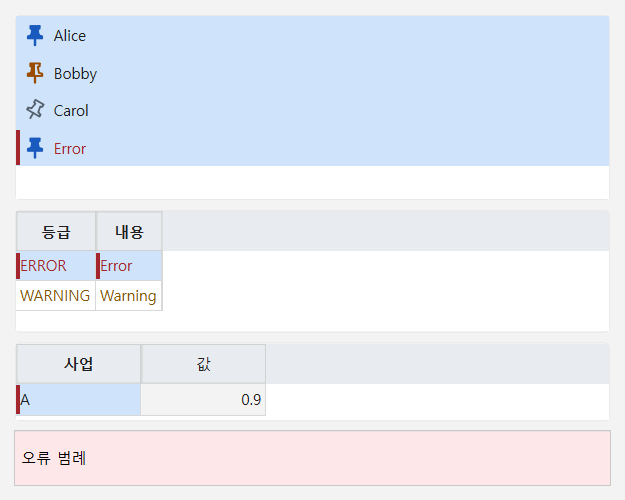
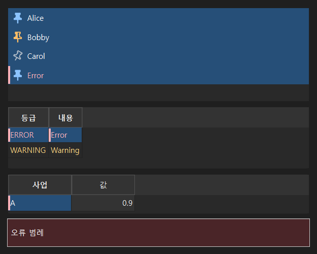

# 자동 저장·실행 이력·테마 구현 결과와 노트북 인계

## 현재 상태

2026-11-28 기능 구현과 코디네이터의 **최종 소스 독립 검토·회귀 검증을 완료**했다. 아래 실제 장치·플랫폼 경계는 남아 있다. GitHub 게시 결과와 병합 커밋은 `SESSION.md` 최신 항목을 따른다.

배포 EXE는 새로 만들지 않았다. 이번 기능은 **GitHub의 최신 소스를 Python으로 실행**해 확인한다. 이전 `publish/win/Prouman.exe`를 열어 새 기능 여부를 판단하지 않는다.

## 구현한 기능

| 기능 | 동작 |
| --- | --- |
| 실시간 저장 | 실적·계획의 입력/결과 업무 변경을 셀 편집 완료·붙여넣기·순서 변경 등의 단위로 원본 YAML에 반영한다. |
| 저장·오류 구분 | 잘못된 합계·빈 수량 등 수정 중 작업자료도 저장하고 오류를 알린다. 오류가 있으면 최종 결과·계획 확정·엑셀 결과 생성을 막는다. 숫자 칸의 새 문자 입력은 차단한다. |
| 원본 보호 | 관련 사업·여러 연도 사람/계획 파일을 한 묶음으로 바꾸며 실패 시 복구한다. 외부 변경·미지원 필드·인코딩 오류를 감지한다. 복구 실패 파일은 보존하고 추가 쓰기를 막는다. |
| 실행 취소/다시 실행 | Ctrl+Z/Ctrl+Y로 한 단계씩, 편집 메뉴의 짧은 이력에서 여러 단계씩 이동한다. 실적·계획·연도 간 변경을 시간순으로 관리하고 이동 결과도 파일에 저장한다. |
| 이력 수명 | 종료하면 초기화한다. 파일은 최신 저장 상태로 남는다. 원본 재바인딩/문서 교체는 이전 이력을 정리하며 단순 모드·탭·연도 탐색은 정리하지 않는다. |
| 새 문서·통합 파일 | 저장 위치를 명시 선택한다. 여러 원본을 합친 자료는 새 통합 파일에 저장하고 옛 원본은 유지한다. 취소하면 작업자료와 미저장 안내를 유지한다. |
| 파일 메뉴 | 별도 저장/Ctrl+S를 제거했다. 저장 위치 지정, 작업자료 묶음/단일 파일 사본, 계획 실적용 확정 내보내기를 구분한다. 사본 저장 후에도 자동 저장 대상은 원래 원본이다. |
| metadata | 파일 공통·사람·사업의 자유 정보를 계산에서 제외하고 보존한다. 통합 파일에서는 원본별 공통 정보를 `metadata.prouman_source_metadata`에 보관한다. |
| 밝은/어두운 테마 | 파랑 선택색·중립 회색 배경, 이름·압정 3상태·오류/경고·현재 셀을 함께 개선했다. 사용자 고대비 팔레트를 우선한다. |

계산 알고리즘, 실적 연간 목표, 계획 순위 규칙, fixed 월 고정 계약은 바꾸지 않았다.

### 테마 검토 이미지

Windows 플랫폼·windows11 스타일의 별도 시험 위젯이다. 실제 업무 자료가 아니며, 물리 DPI·실마우스·OS 고대비 시험을 대신하지 않는다.

밝은 테마:



어두운 테마:



### 사용 중 주의

- **수정은 원본에 즉시 반영된다.** 처음에는 업무 자료를 별도 폴더에 복사해 시험한다.
- 정상 저장에는 별표/종료 저장 질문이 없다. 저장 위치 미지정·실패·충돌 등 해결할 일이 있을 때만 보호 안내가 남는다.
- 프로그램이 실행 중인 YAML을 다른 편집기로 바꾸면 충돌을 알려 쓰기를 차단한다. 오래된 문서를 계속 덮어쓰지 말고 원본을 확인해 다시 불러온다.
- YAML을 재작성하므로 주석·원래 서식·따옴표 형태까지 보존하지는 않는다. 임의 추가 정보는 `metadata`에 둔다. YAML 문법·중복 키·위험 태그 검사는 유지한다.
- 메뉴 이력의 N번째 항목은 최근 N개를 함께 취소/재적용한다. 중간 작업을 건너뛰고 특정 작업 하나만 취소하는 기능이 아니다.
- `.bak`은 기존 실행별 첫 덮어쓰기 백업이며 실행 취소 이력과 다르다. 중요한 업무 자료는 별도 사본도 보관한다.

## 검증 결과

### 코디네이터가 직접 확인한 내용

- 단계별 관련 시험 18 → 33 → 48 → 60 → 75 → 89개를 직접 재실행하며 파일 저장/실패 복구/이력/바인딩/사본을 검토했다.
- 최초 반려 시 6개 중 5개가 실패했던 핵심 수용 점검은 최종 **6개 모두 통과**했다. 실제 파일 저장, 정상 저장 후 별표/종료 질문 소멸, metadata 왕복, 수동 저장 제거, 이력 메뉴를 확인했다.
- 실제 임시 Qt 편집기에 값을 입력하고 Enter를 누르지 않은 상태에서 종료·작업모드 전환·연도 전환을 각각 수행한 추가 점검 **3개 모두 통과**했다. 수정한 연도만 원본에 반영되고 종료 저장 질문은 없었다.
- Windows11 스타일의 밝은/어두운 실제 위젯 이미지를 직접 열어 이름·압정·선택·오류의 대비를 확인했다.
- 최종 독립 스냅샷의 표준 전체 회귀: **297개 실행·291개 통과·6개 skip·실패/오류 0개**(약 38.5초). 테스트 helper의 PowerShell 자식 출력과 UTF-8 디코딩 계약을 일치시킨 후의 소스다. 초기에는 기존 출력 인코딩 오류 4개가 재현됐으며 그 이전 실행을 통과로 바꾸어 기록하지 않는다.
- 같은 최종 소스의 **Windows 네이티브 플랫폼 테마 시험 3개 통과**, CLI 조회 **6종 종료 0**, 새 GUI 시험의 **Qt 미설치 모의 73개 skip·오류 없음**을 직접 확인했다.
- 실제 게시할 Python 소스/시험 42개 파일의 SHA-256을 시험 스냅샷과 대조해 차이가 없음을 확인했다. 문서·이미지는 별도 검토했다.
- Windows·Python **3.14.7**·PySide6 **6.12.0** 기준이다. 최종 스냅샷은 승인된 임시 경로의 `prouman-review-snapshot-wbvcy_jy`이며 전체 로그/소스 지문을 보관했다.

### 구현자가 실행한 시험

- 최종 테마 단계의 임시 Git HEAD fixture 전체 unittest: 297개 중 291개 통과·6개 skip.
- Windows 플랫폼의 Fusion/Windows/windowsvista/windows11 렌더링 시험 3개 통과.
- CLI 기본·`--person`·`--project`·`--all-people`·`--all-projects`·`--all` 각각 종료 0.
- 새 GUI 시험의 Qt 미설치 모의 발견 시 73개 skip·오류 없음.

각 수용항목과 시험의 대응·남은 경계는 [26개 수용행렬](autosave-history-acceptance.md), 반려 및 보완 과정은 [독립 검토서](autosave-history-review-20261128.md)에 있다.

### 아직 실제 확인하지 못한 경계

Linux에서의 이번 변경 전체 실행, 실제 OS 고대비/테마 전환, 물리 고DPI 모니터, 실마우스/IME별 입력, 실제 잠금/권한 거부/저장장치 제거·전원 중단은 별도 확인이 필요하다. Windows 숨김 창 렌더링·offscreen·실패 주입을 실제 물리 장치 시험으로 해석하지 않는다. 지문 검사와 파일 교체 사이의 짧은 경쟁 창을 OS 잠금으로 없애지는 않는다.

## 노트북에서 실행

### 1. 최신 소스 받기

처음 받는 경우:

```powershell
git clone https://github.com/hankjeon/prouman.git
cd prouman
```

이미 저장소가 있는 경우 먼저 로컬 변경을 확인한다. 변경을 버리거나 강제 reset하지 않는다.

```powershell
git status --short --branch
git switch main
git pull --ff-only origin main
```

로컬 변경으로 전환/갱신이 막히면 별도로 보존하고 원인을 확인한다. 이 기능을 시험하려고 기존 업무 자료를 강제로 덮어쓰지 않는다.

### 2. Windows 소스 GUI

Python 3.10 이상이 필요하며 이번 Windows 시험은 Python 3.14.7을 사용했다. 기존 `.venv`가 있으면 생성 명령은 생략한다.

```powershell
python -m venv .venv
.\.venv\Scripts\python.exe -m pip install -r requirements-gui.txt
.\.venv\Scripts\python.exe src\gui.py
```

`requirements.txt`만 설치하면 CLI 의존성만 설치된다. **GUI에는 `requirements-gui.txt`가 필요하다.** 파일 메뉴에서 별도 폴더에 복사한 사업·사람 또는 계획 YAML을 불러온다.

Linux 소스 실행:

```bash
python3 -m venv .venv
.venv/bin/python -m pip install -r requirements-gui.txt
.venv/bin/python src/gui.py
```

Linux Qt 시스템 라이브러리·오프라인 설치는 [README](../README.md)를 따른다. 이번 변경의 Linux 전체 검증을 마쳤다는 의미는 아니다.

### 3. 테스트

**실제 업무 YAML을 수정해 둔 폴더에서는 전체 테스트를 직접 실행하지 않는다.** 깨끗한 별도 clone 또는 Git 기준 fixture의 임시 스냅샷에서 실행한다. 제품 시험은 임시 YAML·임시 QSettings를 사용한다.

```powershell
$env:QT_QPA_PLATFORM = 'offscreen'
$env:PYTHONUTF8 = '1'
$env:PYTHONIOENCODING = 'utf-8'
.\.venv\Scripts\python.exe -m unittest discover -s tests -q
```

### 노트북에서 우선 확인할 순서

1. 밝은/어두운 테마에서 선택 이름·압정과 포커스를 옮긴 뒤의 대비.
2. 임시 자료의 참여율·사업명·사람/사업 순서를 수정한 뒤 실제 YAML 반영.
3. Ctrl+Z/Ctrl+Y와 이력 메뉴의 여러 단계 이동, 실적/계획/연도 간 이동.
4. 새 문서/연도와 여러 원본 통합의 위치 선택 취소/성공, 옛 원본 보존.
5. 다른 이름/폴더 사본을 만든 뒤에도 다음 수정은 기존 원본에 저장되는지 확인.
6. 파일 대화상자·실마우스·OS 테마/고대비·DPI/IME 경계를 추가 시험하고 실제 결과를 SESSION에 기록.

## 파일·업무 자료 인계 범위

GitHub에는 이번 소스·테스트·명세·검토/인계 문서를 게시한다. 현재 PC의 미커밋 업무 파일 `myteam/people/people_2026.yaml`과 `.bak`은 게시하지 않는다. 따라서 **현재 PC에서 편집한 최신 업무 자료까지 노트북으로 자동 전송되는 것은 아니다.** 필요하면 사용자가 별도 안전한 방법으로 업무 사본을 전달해야 한다.

최신 이어받기 기록은 저장소 루트의 [SESSION.md](../SESSION.md)를 읽는다. 새 변경은 그 문서의 필수 읽기 순서·자료 보호·검증 경계를 따르고 별도 기능 브랜치에서 진행한다.
